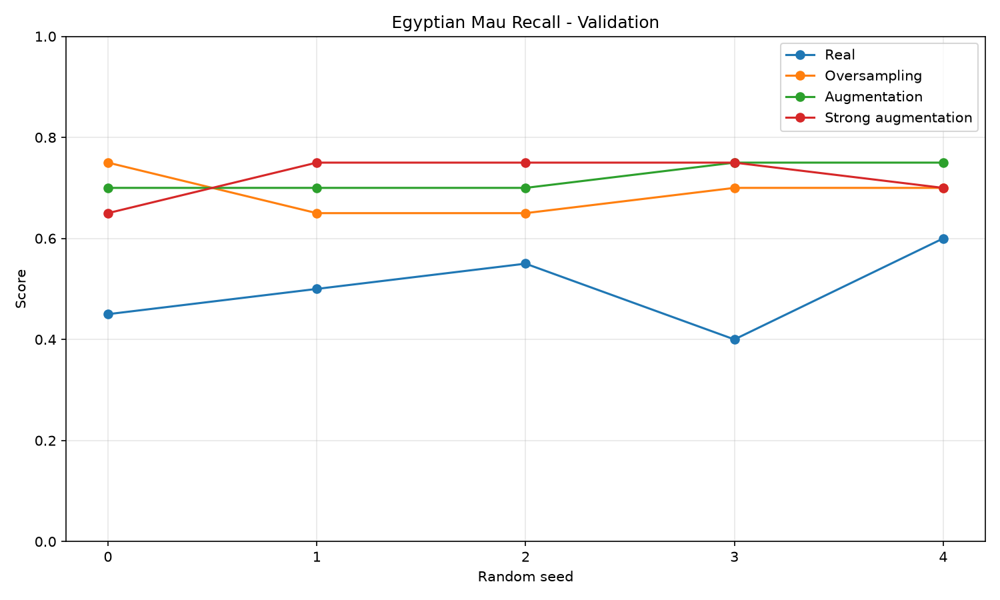
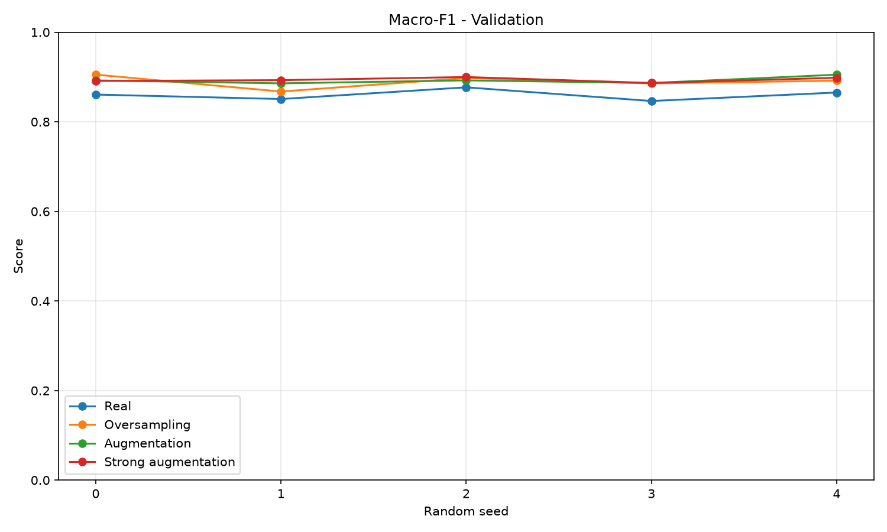

# Experiment Log

This log documents the experiments for each meeting. Validation results are used to compare methods and select configurations; the held-out test set is used only for final evaluation of the selected runs. Results for every random seed are reported, rather than only their averages. Figures are stored in `evidence/`.

## Meeting 1 — Real-data baselines

### Question

How much do oversampling and ordinary augmentation improve Egyptian Mau recall compared with training on the original imbalanced data? Does stronger augmentation lead to a further improvement?

### Experimental setup

The Oxford-IIIT Pet subset contains eight cat breeds. The fixed training split has 15 Egyptian Mau photos and 70 photos for each of the other seven breeds. The validation split contains 20 photos per breed, and the test split contains 30 photos per breed. All runs use the same predefined `data/split.csv` and an ImageNet-pretrained EfficientNet-B0 classifier, trained with the course's standard settings (8 epochs, batch size 64).

The training-data balancing budget is **55 additional Egyptian Mau examples**, making the effective number of Egyptian Mau training examples 70. Each configuration was evaluated with five random seeds (0–4). The primary metric is **Egyptian Mau recall**; **macro-F1** measures performance across all eight classes without weighting the majority breeds more heavily.

The four validation configurations are:

| Run | Method | Additional minority examples |
|---|---|---|
| `m1-real` | Real-data baseline | None |
| `m1-oversample` | Oversampling | 55 repeated real photos |
| `m1-augment` | Ordinary augmentation | 55 randomly transformed real photos |
| `m1-augment-strong` | Stronger augmentation | 55 randomly transformed real photos, using larger transformation ranges |

### How `oversample()` works

The function `oversample(minority_photos, budget, rng)` returns a list of exactly `budget` filenames, allowing repeats. For a nonempty minority list it divides the budget by the number of source photos, repeats every filename the quotient number of times, randomly selects distinct filenames for the remainder using the supplied `rng`, and shuffles the final list with that same generator.

For 15 Egyptian Mau source photos and a budget of 55, each filename is included at least three times; ten randomly selected filenames are included a fourth time. This keeps the extra sampling as even as possible, avoids systematically favouring particular photos, and is reproducible when the same random seed is used. Oversampling does **not** introduce new visual information: the additional training instances reference existing photos.

### How `augment()` works, and why these transforms

The implemented function returns a randomly transformed **copy** of the input PIL image. The selected ordinary augmentation contains:

- Random horizontal flip with probability 0.5.
- Random rotation within ±10°.
- Random brightness variation of 0.2.
- Random contrast variation of 0.2.
- Random saturation variation of 0.1.

These transformations model plausible changes in camera orientation, pose, and lighting while generally preserving recognizable breed features. A separate random transformation can be drawn each time a photo is loaded, increasing visual variability compared with exact repetition. The ranges were deliberately kept moderate to avoid excessive distortion of the cat's appearance.

A second variant changed only the augmentation policy, keeping the dataset, model, balancing budget and training procedure the same:

| Transformation | Ordinary augmentation | Strong augmentation |
|---|---:|---:|
| Horizontal flip probability | 0.5 | 0.5 |
| Maximum absolute rotation | 10° | 20° |
| Brightness variation | 0.2 | 0.3 |
| Contrast variation | 0.2 | 0.3 |
| Saturation variation | 0.1 | 0.2 |

After running both variants, the source code was restored to the **ordinary** augmentation settings shown above. The saved results of the stronger variant remain available under its separate run name.

### Commands

The following commands were used from the project root:

```powershell
uv run synth-data
uv run pytest -q
uv run synth-train --name m1-real --method real
uv run synth-train --name m1-oversample --method oversample
uv run synth-train --name m1-augment --method augment
```

Then, after temporarily increasing the augmentation ranges in `src/synthdata/balance.py`:

```powershell
uv run synth-train --name m1-augment-strong --method augment
```

The ordinary augmentation parameters were restored before proceeding. Results are saved separately in `runs/<name>/results.json`. The comparison plots were generated from these JSON files with:

```powershell
uv run python plot_results.py
```

### Results on validation

The following tables report **all five seeds** for each configuration. The per-seed scores are shown to three decimal places.

#### Egyptian Mau recall — validation

| Seed | Real | Oversampling | Augmentation | Strong augmentation |
|---|---:|---:|---:|---:|
| 0 | 0.450 | 0.750 | 0.700 | 0.650 |
| 1 | 0.500 | 0.650 | 0.700 | 0.750 |
| 2 | 0.550 | 0.650 | 0.700 | 0.750 |
| 3 | 0.400 | 0.700 | 0.750 | 0.750 |
| 4 | 0.600 | 0.700 | 0.750 | 0.700 |
| **Mean** | **0.500** | **0.690** | **0.720** | **0.720** |

#### Macro-F1 — validation

| Seed | Real | Oversampling | Augmentation | Strong augmentation |
|---|---:|---:|---:|---:|
| 0 | 0.861 | 0.905 | 0.892 | 0.891 |
| 1 | 0.851 | 0.868 | 0.886 | 0.893 |
| 2 | 0.877 | 0.898 | 0.892 | 0.900 |
| 3 | 0.846 | 0.886 | 0.887 | 0.887 |
| 4 | 0.865 | 0.892 | 0.905 | 0.898 |
| **Mean (approx.)** | **0.860** | **0.890** | **0.892** | **0.894** |

The figures below show the individual seed values for all four configurations (not just aggregated means):

**Egyptian Mau recall across five seeds**



**Macro-F1 across five seeds**



### What I see

Both balancing methods improved minority-class recognition over the real-data baseline. Mean Egyptian Mau recall increased from **0.500** for the baseline to **0.690** with oversampling (+0.190) and **0.720** with ordinary augmentation (+0.220). The gain is visible across the individual seeds, not just in the mean. Macro-F1 also increased, from approximately **0.860** to **0.890** and **0.892**, respectively.

The stronger augmentation variant achieved the **same mean recall (0.720)** as the ordinary variant. Its macro-F1 was only marginally higher (about 0.894 versus 0.892). This small difference does not establish a meaningful advantage from stronger transformations, particularly with only five training seeds.

**Decision based on validation:** retain `m1-augment` (ordinary augmentation) as the preferred augmentation policy because it matches the stronger variant's mean minority recall while applying less aggressive changes to the training photos. The stronger variant is documented as an additional validation experiment, not chosen on the basis of test performance.

### Test results of the three baselines

After making the augmentation selection using validation results, the three baseline runs were evaluated on the held-out test split with their five saved models each:

```powershell
uv run synth-test --run m1-real
uv run synth-test --run m1-oversample
uv run synth-test --run m1-augment
```

Individual test scores are saved in the corresponding `runs/<name>/test-results.json` files. The test split was **not used to select or tune** the augmentation policy.

#### Egyptian Mau recall — test

| Seed | Real | Oversampling | Augmentation |
|---|---:|---:|---:|
| 0 | 0.467 | 0.700 | 0.733 |
| 1 | 0.500 | 0.667 | 0.733 |
| 2 | 0.567 | 0.667 | 0.767 |
| 3 | 0.433 | 0.700 | 0.733 |
| 4 | 0.600 | 0.733 | 0.733 |
| **Mean (approx.)** | **0.513** | **0.693** | **0.740** |

#### Macro-F1 — test

| Seed | Real | Oversampling | Augmentation |
|---|---:|---:|---:|
| 0 | 0.843 | 0.883 | 0.875 |
| 1 | 0.849 | 0.882 | 0.878 |
| 2 | 0.880 | 0.886 | 0.883 |
| 3 | 0.839 | 0.875 | 0.887 |
| 4 | 0.864 | 0.866 | 0.887 |
| **Mean (approx.)** | **0.855** | **0.878** | **0.882** |

*Reporting note:* The test scores in these tables were transcribed from the console output rounded to three decimal places. Means are therefore approximate. The JSON result files contain the original precision. The same three-decimal display convention is used for validation scores.

### Meeting 1 conclusions

The test results follow the overall validation trend. Compared with the original imbalanced baseline, oversampling improved mean test Egyptian Mau recall from approximately **51.3% to 69.3%**, while ordinary augmentation improved it to **74.0%**. Mean test macro-F1 also increased, from about **0.855** for real data to **0.878** for oversampling and **0.882** for augmentation.

The results suggest that balancing the minority class is useful for this dataset and training setup, and that ordinary augmentation may provide an additional benefit over exact repetition. These are empirical findings from a small fixed dataset and five seeds; they do not establish that the same ranking must hold for other architectures or datasets.

The `m1-real`, `m1-oversample`, and `m1-augment` test results serve as the **real-data reference baselines** for Meeting 2.

---

## Meeting 2 — Text-to-image generation

*To be completed after Meeting 2 experiments.*

- **Question:**
- **Setting changed in each pool (one at a time):**
- **Commands:**
- **Contact sheets:** (good and bad images, with the failure types identified)
- **Results on validation:** (table with every seed and plot)
- **What I see:**
- **Pool I take forward, and why:**
- **Its test result, compared with the baselines:**

## Meeting 3 — Generation from training photos

*To be completed after Meeting 3 experiments.*

- **Question:** How close to the real photos should the synthetic images be?
- **img2img strength values and IP-Adapter scale values tried:**
- **Commands:**
- **Contact sheets:**
- **Results on validation:**
- **What I see:**
- **Best run of each mode, and its test result:**

## Meeting 4 — Editing training photos

*To be completed after Meeting 4 experiments.*

- **Question:** Does the classifier need new cats or new backgrounds?
- **Background prompts and outpainting scales tried:**
- **Commands:**
- **Contact sheets:**
- **Results on validation:**
- **What I see:**
- **Best run of each mode, and its test result:**

## Final comparison

*To be completed once Meetings 1–4 are finished.*

- **Runs chosen in Meetings 1–4:**
- **Results:** (table and plot of their `test-results.json` files)
- **Did the validation ranking hold on the test photos?**
- **Recommendation:** Use, revise, or reject synthetic data for this task.
